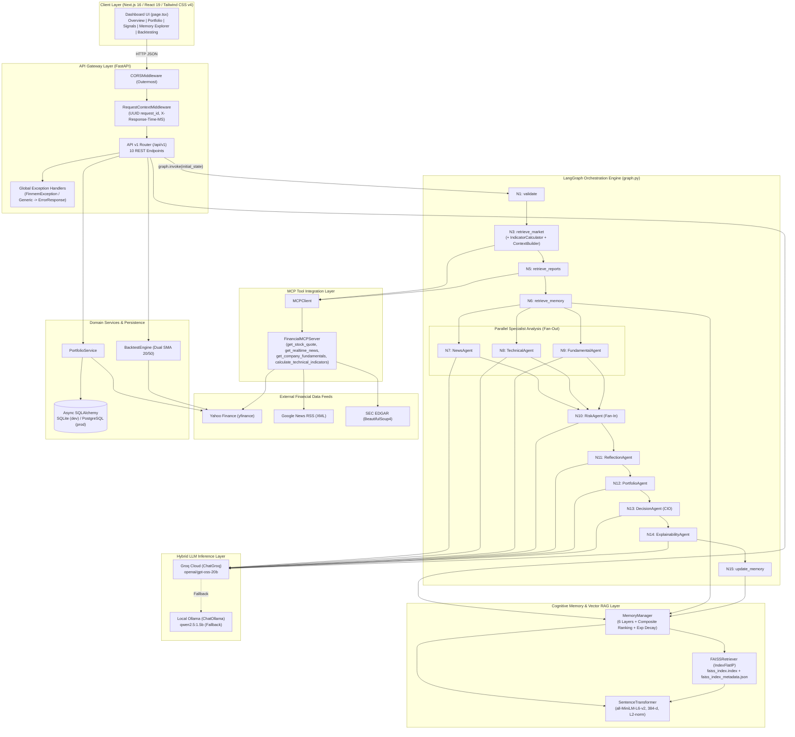
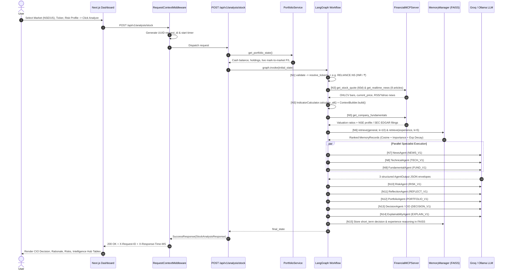
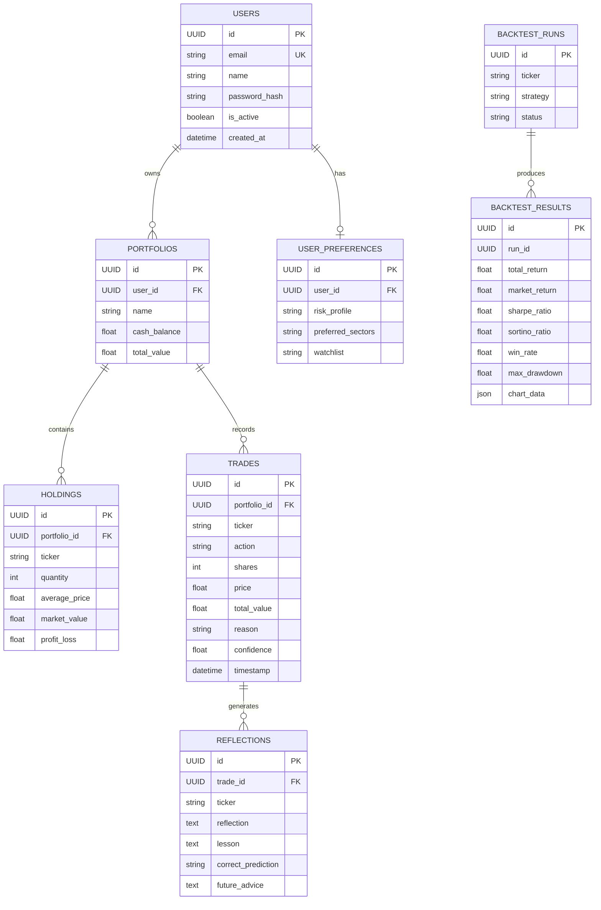

# FINMEM-X (`AI-Stock-Research`) — Complete Interview Master Guide

> **How to use this guide:** Read it phase by phase. It covers the **High-Level Design (HLD)**, **Low-Level Design (LLD)**, **Technology Glossary (every tool/library explained from scratch)**, **Architecture Comparisons ("Why this over alternatives?")**, **Phase-Wise Line-by-Line Code Walkthroughs**, **Honest Codebase Trade-offs**, and **Interview Q&A**.

---

## Table of Contents

1. [Project Elevator Pitch (30s & 2-Min Interview Scripts)](#1-project-elevator-pitch)
2. [Repository Map & Active vs. Prototype Modules](#2-repository-map--active-vs-prototype-modules)
3. [Complete Technology & Concept Glossary (Everything Used in This Project)](#3-complete-technology--concept-glossary)
4. [High-Level Design (HLD)](#4-high-level-design-hld)
5. [Low-Level Design (LLD)](#5-low-level-design-lld)
6. [Why This Architecture? (Comparisons Against Alternatives)](#6-why-this-architecture-comparisons-against-alternatives)
7. [Phase-Wise Line-by-Line Code Walkthrough (Phases 1 to 8)](#7-phase-wise-line-by-line-code-walkthrough)
   - [Phase 1: Core Infrastructure, Config, Middleware & Error Handling](#phase-1-core-infrastructure-config-middleware--error-handling)
   - [Phase 2: Database Layer & Domain ORM Models](#phase-2-database-layer--domain-orm-models)
   - [Phase 3: External Data Adapters, Quantitative Indicators & MCP Tool Layer](#phase-3-external-data-adapters-quantitative-indicators--mcp-tool-layer)
   - [Phase 4: Embeddings, FAISS Vector Store, RAG & 6-Layer Cognitive Memory](#phase-4-embeddings-faiss-vector-store-rag--6-layer-cognitive-memory)
   - [Phase 5: Multi-Agent System, Prompt Registry & JSON Recovery](#phase-5-multi-agent-system-prompt-registry--json-recovery)
   - [Phase 6: LangGraph State Machine & Orchestration Topology](#phase-6-langgraph-state-machine--orchestration-topology)
   - [Phase 7: Business Services, Backtesting Engine & REST API v1](#phase-7-business-services-backtesting-engine--rest-api-v1)
   - [Phase 8: Frontend Dashboard (Next.js 16, React 19, Tailwind v4, Base UI)](#phase-8-frontend-dashboard-nextjs-16-react-19-tailwind-v4-base-ui)
8. [Senior-Level Audit: Real Trade-Offs & Production Improvements](#8-senior-level-audit-real-trade-offs--production-improvements)
9. [Top Interview Questions & Model Answers](#9-top-interview-questions--model-answers)

---

## 1. Project Elevator Pitch

### 30-Second Pitch
> **FINMEM-X** is a multi-agent AI financial decision-support system built with **FastAPI**, **LangGraph**, **MCP (Model Context Protocol)**, **FAISS cognitive memory**, and **Next.js**. Given any US (`AAPL`, `NVDA`) or Indian NSE/BSE (`RELIANCE`, `TCS`) stock ticker and a user risk profile, it fetches live market OHLCV data, news, and corporate/SEC filings via standardized MCP tools, computes quantitative technical indicators, retrieves semantically relevant historical memories with exponential time-decay ranking, runs **8 specialized LLM agents** (News, Technical, Fundamental in parallel, followed by Risk, Reflection, Portfolio, CIO Decision, and Explainability), and surfaces an auditable **BUY / SELL / HOLD** recommendation alongside paper trading and a Dual-SMA backtester.

### 2-Minute Architecture Pitch
> Traditional single-prompt LLM stock wrappers suffer from three flaws: they hallucinate math on raw price arrays, mix news hype with chart signals, and suffer from amnesia across sessions. **FINMEM-X** solves all three:
> 1. **Deterministic Math + MCP Tool Standardization:** Numerical indicators (RSI-14, MACD, EMA-20/50, Bollinger Bands, ATR-14) are computed deterministically in `pandas`/`numpy` (`IndicatorCalculator`), and market/news/filing feeds are encapsulated behind a schema-driven **MCP Server/Client** (`FinancialMCPServer`).
> 2. **DAG Orchestration via LangGraph:** A typed `GraphState` flows through sequential data ingestion, **parallel specialist fan-out** (`NewsAgent`, `TechnicalAgent`, `FundamentalAgent`), and a **sequential governance pipeline** (`RiskAgent` -> `ReflectionAgent` -> `PortfolioAgent` -> `DecisionAgent` -> `ExplainabilityAgent` -> `update_memory`).
> 3. **6-Layer Cognitive Memory + Composite Re-Ranking:** `MemoryManager` organizes memories across 6 cognitive layers (`working`, `short_term`, `long_term`, `experience`, `reflection`, `knowledge`) in a normalized **FAISS `IndexFlatIP`** vector index (`all-MiniLM-L6-v2`, 384-d) and re-ranks retrieval by combining **cosine similarity (45%)**, **importance (20%)**, **exponential recency decay (15%)**, **reliability (10%)**, and **context (10%)**.
> 4. **Resilient Inference & Simulation:** `BaseAgent` enforces a strict JSON envelope with 3-stage fault-tolerant JSON parsing and graceful fallbacks; `get_llm()` uses cloud **Groq** (`openai/gpt-oss-20b`) with automatic fallback to local **Ollama** (`qwen2.5:1.5b`). Users can execute paper trades against an async SQLAlchemy portfolio and validate strategies using a look-ahead-free Dual-SMA `BacktestEngine`.

---

## 2. Repository Map & Active vs. Prototype Modules

Before diving into code, **know what is active v1 code vs. earlier prototype code** in your repository (interviewers respect engineers who can distinguish active execution paths from legacy scaffolding):

| Layer | Active v1 Module (Mounted by `main.py`) | Earlier Prototype / Legacy Module (Not mounted by `main.py`) |
| :--- | :--- | :--- |
| **App Entry & API** | `backend/app/main.py` -> `backend/app/api/v1/routes.py` | `backend/app/api/router.py` |
| **Config** | `backend/app/config/settings.py` | `backend/app/core/config.py` |
| **Database & ORM** | `backend/app/core/database.py` + `backend/app/models/*.py` | `backend/app/db/database.py` + `backend/app/db/models.py` |
| **LangGraph Workflow** | `backend/app/langgraph/graph.py` + `backend/app/langgraph/state.py` | `backend/app/agents/graph.py`, `nodes.py`, `state.py` + `backend/test_graph.py` |
| **Agents** | `backend/app/agents/base.py` + 8 agent classes (`news.py`, `technical.py`, etc.) | Procedural functions in `backend/app/agents/nodes.py` |
| **Backtesting** | `backend/app/backtesting/engine.py` (`BacktestEngine`) | `backend/app/core/backtest.py` (`run_backtest`) |
| **Vector Memory** | `backend/app/memory/manager.py` + `backend/app/rag/retriever.py` | `backend/app/memory/vector_store.py` |
| **Adapters / Data** | `backend/app/mcp/tools.py`, `adapters/yahoo.py`, `sec.py`, `ollama.py` | `services/data_collector.py`, `services/reports.py`, `services/scheduler.py` |

> **Empty scaffold packages** in `backend/app/`: `logging_service/__init__.py`, `portfolio/__init__.py`, `repositories/__init__.py`, `scheduler/__init__.py`, `trading/__init__.py`.

---

## 3. Complete Technology & Concept Glossary

Here is **every single library, protocol, and concept** used in this project and *why* it exists:

| Technology / Package | Category | What it does in FINMEM-X |
| :--- | :--- | :--- |
| **FastAPI** | Backend Web Framework | Async Python API server with automatic OpenAPI/Swagger (`/docs`), dependency injection (`Depends(get_db)`), lifespan hooks, and Pydantic validation. |
| **Uvicorn (`uvicorn[standard]`)** | ASGI Server | Runs the FastAPI ASGI application asynchronously with high-performance HTTP handling. |
| **Pydantic & `pydantic-settings`** | Validation & Config | Validates API request/response JSON schemas (`schemas/analysis.py`) and loads `.env` config into typed Python attributes (`config/settings.py`). |
| **SQLAlchemy (`[asyncio]`)** | ORM & DB Toolkit | Maps Python classes (`User`, `Portfolio`, `Holding`, `Trade`, etc.) to SQL tables asynchronously without blocking the event loop. |
| **`aiosqlite` & `asyncpg`** | Async DB Drivers | `aiosqlite` enables async SQLite (`finmemx.db`) for zero-setup local dev; `asyncpg` enables high-speed async PostgreSQL for production. |
| **`psycopg2-binary` & `alembic`** | Sync Driver & Migrations | Included in `requirements.txt` for production PostgreSQL schema migrations. |
| **LangGraph (`StateGraph`)** | Agent Orchestration | Models the multi-agent pipeline as a stateful Directed Acyclic Graph (DAG) with shared `TypedDict` state, parallel fan-out, and deterministic joins. |
| **LangChain (`langchain`, `langchain-community`, `langchain-ollama`, `langchain-groq`)** | LLM Abstraction | Unified `.invoke(prompt)` interface across Groq cloud (`ChatGroq`) and local Ollama (`ChatOllama`). |
| **Groq (`openai/gpt-oss-20b`)** | Cloud LLM Inference | Ultra-fast LPU-accelerated LLM inference (primary provider when `GROQ_API_KEY` is set). |
| **Ollama (`qwen2.5:1.5b`)** | Local LLM Runtime | Runs open-weight LLMs locally at `http://localhost:11434` as an offline/zero-cost fallback. |
| **MCP (Model Context Protocol)** | Tool Interface Standard | Standardizes how AI workflows discover (`list_tools`) and call (`execute_tool`) financial data tools using JSON Schemas (`MCP_TOOLS_SPEC`). |
| **`sentence-transformers` (`all-MiniLM-L6-v2`)** | Embedding Model | Converts financial text/lessons into **384-dimensional L2-normalized dense vectors** locally on CPU. |
| **FAISS (`faiss-cpu`, `IndexFlatIP`)** | Vector Search Engine | Facebook AI Similarity Search; `IndexFlatIP` performs exact Inner Product search (equivalent to Cosine Similarity on normalized vectors). |
| **`yfinance`** | Market Data Client | Fetches live `fast_info` quotes, historical OHLCV bars, company fundamentals (`stock.info`), and fallback news for US & `.NS`/`.BO` Indian stocks. |
| **`pandas` & `numpy`** | Quantitative Computing | Vectorized math for technical indicators (`IndicatorCalculator`) and historical strategy simulation (`BacktestEngine`). |
| **`requests` & `beautifulsoup4`** | HTTP & HTML Scraping | Scrapes SEC EDGAR (`tableFile2`) for US 10-K/10-Q filings (`SECEdgarAdapter`). |
| **`urllib.request` & `xml.etree.ElementTree`** | Stdlib RSS Parsing | Fetches & parses Google News RSS XML feeds for US and Indian equities without API keys or rate limits. |
| **`httpx`** | Async HTTP Client | Used in `monitoring/health.py` to asynchronously ping Ollama `/api/tags`. |
| **`apscheduler`** | Task Scheduling | Used in legacy `services/scheduler.py` (`AsyncIOScheduler`) for cron-based daily OHLCV ingestion. |
| **Docker & Docker Compose** | Containerization | `docker/docker-compose.yml` provisions `postgres:16` (with healthcheck) and `ollama/ollama:latest`. |
| **Next.js 16 + React 19 + TypeScript 5** | Frontend Framework | React SPA/App Router dashboard (`frontend/src/app/page.tsx`) communicating with FastAPI over JSON REST. |
| **Tailwind CSS v4 + `@base-ui/react` + `shadcn` + `lucide-react`** | UI System | Utility-first styling with OKLCH CSS tokens, accessible unstyled primitives (`Tabs`, `Button`), and crisp icons. |

---

## 4. High-Level Design (HLD)

### 4.1 System Architecture Diagram



### 4.2 End-to-End Sequence Diagram (`POST /api/v1/analysis/stock`)



---

## 5. Low-Level Design (LLD)

### 5.1 Class Diagram

```mermaid
classDiagram
    class BaseAgent {
        <<abstract>>
        +str name
        +str description
        +str prompt_id
        +execute(state: dict)* dict
        +validate(state: dict) bool
        +parse_json(text: str) dict
        +build_envelope(result, elapsed, status, warnings) dict
        +run(state: dict) dict
    }

    class NewsAgent { +prompt_id = "NEWS_V1" }
    class TechnicalAgent { +prompt_id = "TECH_V1" }
    class FundamentalAgent { +prompt_id = "FUND_V1" }
    class RiskAgent { +prompt_id = "RISK_V1" }
    class ReflectionAgent { +prompt_id = "REFLECT_V1" }
    class PortfolioAgent { +prompt_id = "PORTFOLIO_V1" }
    class DecisionAgent { +prompt_id = "DECISION_V1" }
    class ExplainabilityAgent { +prompt_id = "EXPLAIN_V1" }

    BaseAgent <|-- NewsAgent
    BaseAgent <|-- TechnicalAgent
    BaseAgent <|-- FundamentalAgent
    BaseAgent <|-- RiskAgent
    BaseAgent <|-- ReflectionAgent
    BaseAgent <|-- PortfolioAgent
    BaseAgent <|-- DecisionAgent
    BaseAgent <|-- ExplainabilityAgent

    class MemoryManager {
        +tuple LAYERS
        +FAISSRetriever retriever
        +store(content, layer, ticker, importance, source, extra)
        +retrieve(query, k, layer) list
        +calculate_importance(...) float
        +should_promote(importance) bool
        +should_delete(importance) bool
        -_rank(results) list
        -_recency_score(timestamp_str) float
    }

    class MemoryRecord {
        +str page_content
        +dict metadata
        +float score
        +get(key, default)
        +to_dict() dict
    }

    class FAISSRetriever {
        +str index_path
        +str metadata_path
        +int dimension
        +faiss.IndexFlatIP index
        +list metadata
        +add(text, metadata)
        +add_batch(texts, metadatas)
        +search(query, k) list
        -_save()
    }

    class MCPClient {
        +FinancialMCPServer server
        +get_available_tools() list
        +call_tool(tool_name, arguments) dict
    }

    class FinancialMCPServer {
        +list_tools() list
        +execute_tool(name, arguments) dict
    }

    class PortfolioService {
        +AsyncSession session
        +get_or_create_default_user() User
        +get_default_portfolio() Portfolio
        +get_portfolio_state() dict
        +add_initial_holding(ticker, qty, avg_price) dict
        +execute_trade(ticker, action, qty, price, reason) dict
    }

    class BacktestEngine {
        +run(ticker, period) dict
    }

    class IndicatorCalculator {
        +calculate_all(price_data)$ dict
    }

    MemoryManager --> FAISSRetriever : delegates vector ops
    MemoryManager ..> MemoryRecord : wraps results
    MCPClient --> FinancialMCPServer : dispatches tools
```



### 5.2 Database Entity-Relationship Diagram (`backend/app/models/*`)



> Additional tables registered in `init_db()`: `companies`, `stock_prices`, `technical_indicators`, `news_articles`, `news_sentiments`, `company_reports` (`market.py`), `working_memories`, `short_term_memories`, `experience_memories`, `reflection_memories`, `knowledge_memories` (`memory.py`), and `api_logs`, `agent_logs`, `prompt_versions`, `model_configs` (`system.py`).

### 5.3 Standard Data Envelopes
- **API Success (`SuccessResponse`):** `{"success": true, "message": "...", "data": ..., "timestamp": "<UTC ISO>", "request_id": "<UUID>"}`
- **API Error (`ErrorResponse`):** `{"success": false, "error": {"code": "...", "message": "...", "details": ...}, "request_id": "<UUID>", "timestamp": "<UTC ISO>"}`
- **Agent Output (`AgentOutput` / `build_envelope`):** `{"agent": "<Name>", "status": "SUCCESS|SKIPPED|FAILED", "confidence": 0.0..1.0, "result": {...}, "warnings": [...], "execution_time_ms": float}`

---

## 6. Why This Architecture? (Comparisons Against Alternatives)

| Design Choice | What FINMEM-X Does | Alternatives | Why FINMEM-X is Better for This Use Case |
| :--- | :--- | :--- | :--- |
| **Orchestration** | **LangGraph `StateGraph`** with explicit DAG edges & typed `GraphState` | LangChain `AgentExecutor` (ReAct loop) / CrewAI / AutoGen | ReAct loops let the LLM decide control flow (might skip risk check or loop infinitely). LangGraph guarantees **parallel specialist execution** + **mandatory Risk/Portfolio/CIO gates** with deterministic auditability. |
| **Tool Layer** | **MCP Registry (`FinancialMCPServer` + `MCPClient`)** with JSON Schemas | Hardcoded function imports inside agents | Decouples agents from data vendors (`yfinance`, SEC, Google RSS). Swapping a vendor happens in one place, and schemas are already protocol-ready for external MCP clients. |
| **Vector Store** | **FAISS `IndexFlatIP`** + JSON sidecar (`faiss_index.index`) | Pinecone / Weaviate / ChromaDB / SQL `LIKE` | Zero external infrastructure, zero network latency, exact cosine similarity (via L2 normalization). SQL `LIKE` fails on semantic phrasing ("margin squeeze" vs "profit drop"). *(Trade-off: single-node up to ~100K vectors).* |
| **Memory Design** | **6-Layer Cognitive Memory** + Composite Ranking (`0.45*sim + 0.20*imp + 0.15*rec + 0.10*rel + 0.10*ctx`) | Standard similarity-only RAG / plain chat buffer | Similarity-only RAG lets stale 2021 articles outrank yesterday's earnings. Exponential decay `exp(-0.01*days)` + importance weighting mirrors human trader memory. |
| **LLM Inference** | **Hybrid Groq (`openai/gpt-oss-20b`) + Ollama (`qwen2.5:1.5b`) fallback** | OpenAI-only or Local-only | Cloud speed when `GROQ_API_KEY` is present; $0 offline resilience via Ollama if key is missing or fails. |
| **Technical Math** | **Deterministic `pandas`/`numpy` (`IndicatorCalculator`)** | Asking the LLM to compute RSI/MACD from raw prices | LLMs hallucinate arithmetic over 60 OHLCV rows. Deterministic calculation takes <5ms and turns `TechnicalAgent` into a pure interpreter. |
| **Market Data** | **`yfinance` + Google News RSS (XML) + SEC EDGAR scraping** | Paid Bloomberg / AlphaVantage / NewsAPI | Zero cost, supports both **US (`$`)** and **Indian NSE/BSE (`₹`)** equities, and Google News RSS avoids strict API rate limits. |
| **Backend & DB** | **FastAPI + Async SQLAlchemy (`aiosqlite` dev / `asyncpg` prod)** | Flask / Django (sync) | Native async I/O, strict Pydantic v2 contracts, automatic Swagger docs, zero-Docker SQLite dev that scales to pooled PostgreSQL in prod. |
| **Frontend** | **Next.js 16 + React 19 + Tailwind v4 + Base UI / shadcn** | Streamlit / Gradio | Full control over multi-tab state, dense tabular intelligence hubs, instant market toggles, and production UI polish. |

---

## 7. Phase-Wise Line-by-Line Code Walkthrough

---

### Phase 1: Core Infrastructure, Config, Middleware & Error Handling

#### 1.1 `backend/app/config/settings.py` (Lines 1–44)
- **Lines 1–3**: Imports `os`, `BaseSettings` (Pydantic v2 settings class that reads env vars / `.env` automatically), and `Optional`.
- **Lines 5–13**: Declares `Settings(BaseSettings)` with `PROJECT_NAME`, `API_VERSION = "v1"`, `DEBUG = False`, and SQLite defaults (`sqlite+aiosqlite:///./finmemx.db` for async runtime, `sqlite:///./finmemx.db` for sync tools).
- **Lines 14–20**: Configures LLM defaults: `LLM_PROVIDER = "groq"`, `GROQ_API_KEY: Optional[str] = None`, `GROQ_MODEL = "openai/gpt-oss-20b"`, and Ollama parameters (`http://localhost:11434`, `qwen2.5:1.5b`, `temperature=0.7`, `max_tokens=2048`).
- **Lines 21–26**: Configures RAG (`EMBEDDING_MODEL = "all-MiniLM-L6-v2"`, `EMBEDDING_DIMENSION = 384`, `FAISS_INDEX_PATH = "faiss_index"`) and data sources (`SEC_EDGAR_USER_AGENT`).
- **Lines 27–35**: Security/rate-limit placeholders (`JWT_SECRET_KEY`, `HS256`, `60` min) and cognitive memory constants (`MEMORY_DECAY_FACTOR = 0.01`, `MEMORY_PROMOTION_THRESHOLD = 80.0`, `MEMORY_DELETION_THRESHOLD = 20.0`).
- **Lines 37–44**: `Config.env_file` checks both `backend/.env` and cwd `.env`; `extra = "allow"` ignores unrelated env vars; instantiates global `settings = Settings()`.

#### 1.2 `backend/app/middleware/request_context.py` (Lines 1–20)
- **Line 9**: `class RequestContextMiddleware(BaseHTTPMiddleware):` wraps every incoming HTTP request.
- **Lines 11–13**: Generates `request_id = str(uuid.uuid4())`, binds it to `request.state.request_id`, and captures `start_time = time.time()`.
- **Line 15**: `response = await call_next(request)` hands control to the FastAPI router/endpoint.
- **Lines 16–20**: Computes `duration_ms = round((time.time() - start_time) * 1000, 2)`, sets `X-Request-ID` and `X-Response-Time-MS` response headers, logs completion status, and returns `response`.

#### 1.3 `backend/app/exceptions/handlers.py` (Lines 1–48)
- **Lines 9–15**: `FinmemException` stores machine-readable `code`, human-readable `message`, HTTP `status_code`, and optional `details`.
- **Lines 17–35**: Domain subclasses: `ResourceNotFoundError` (404), `ValidationError` (422), `ExternalServiceError` (503), `AgentExecutionError` (500), `AuthenticationError` (401).
- **Lines 37–38**: `build_error_response()` builds a standardized error dictionary matching `ErrorResponse`.
- **Lines 40–48**: `finmem_exception_handler` returns the custom HTTP status + error payload; `generic_exception_handler` catches unexpected exceptions, logs the full stack trace via `logger.exception`, and returns HTTP `500` with `"INTERNAL_ERROR"` without leaking internal code details to clients.

#### 1.4 `backend/app/main.py` (Lines 1–96)
- **Lines 21–26**: Configures stdout logging (`DEBUG` if `settings.DEBUG` else `INFO`).
- **Lines 30–53 (`lifespan`)**: Async context manager run once at startup/shutdown. Logs banner, calls `await init_db()` inside `try/except` so startup doesn't crash if Postgres is down, yields to serve requests, then logs shutdown.
- **Lines 56–94 (`create_app`)**:
  - Instantiates `FastAPI(..., docs_url="/docs", redoc_url="/redoc", lifespan=lifespan)`.
  - **Lines 67–74**: Adds `CORSMiddleware` first (outermost) and `RequestContextMiddleware` inside it. *(Why? Because if an error or preflight OPTIONS request happens, CORS headers must still be attached on the outer layer!)*
  - **Lines 77–81**: Registers exception handlers and mounts `api_v1_router`.
  - **Lines 84–91**: Exposes `GET /` returning quick discovery links (`/docs`, `/api/v1/health`).

#### 1.5 `backend/app/schemas/` & `monitoring/health.py` & `utils/helpers.py`
- **`schemas/base.py`**: `SuccessResponse` (`success=True`, `data`, `timestamp`, `request_id`) and `ErrorResponse`.
- **`schemas/analysis.py`**: Defines `StockAnalysisRequest`, `AgentOutput`, `StockAnalysisResponse` (22 typed fields), `BacktestRequest`, `BacktestResponse`, `HealthResponse`.
- **`monitoring/health.py`**: `check_ollama()` hits `{OLLAMA_BASE_URL}/api/tags` with a 3s timeout; `check_faiss()` reads `get_retriever().index.ntotal`.
- **`utils/helpers.py`**: `generate_uuid()` and `utc_now()`.

---

### Phase 2: Database Layer & Domain ORM Models

#### 2.1 `backend/app/core/database.py` (Lines 1–66)
- **Lines 9–11**: `class Base(DeclarativeBase): pass` — declarative registry shared by all ORM models.
- **Lines 14–32 (`_make_engine`)**:
  - Reads `url = settings.DATABASE_URL`.
  - If `url.startswith("sqlite")`: calls `create_async_engine(url, echo=settings.DEBUG, connect_args={"check_same_thread": False})`. *(Why? SQLite raises `TypeError` on `pool_size`/`max_overflow`, and `check_same_thread=False` allows async access across worker threads).*
  - Else (PostgreSQL): enables connection pooling `pool_size=20, max_overflow=10`.
- **Lines 37–41**: `AsyncSessionFactory = async_sessionmaker(engine, class_=AsyncSession, expire_on_commit=False)`. *(Why `expire_on_commit=False`? In async SQLAlchemy, expired attributes trigger implicit sync I/O on access, raising `MissingGreenlet`; setting this `False` keeps committed column values in memory).*
- **Lines 44–50 (`get_db`)**: Async generator yielding a session per request and closing it in `finally`.
- **Lines 53–66 (`init_db`)**: Explicitly imports all 7 model files (`# noqa: F401`) so `Base.metadata` contains every table, then runs `await conn.run_sync(Base.metadata.create_all)`.

#### 2.2 Domain Models (`backend/app/models/*.py`)
- **`user.py`**:
  - `User` (`users`): `UUID` PK (`default=uuid.uuid4`), unique indexed `email`, `name`, `password_hash`, `is_active`, UTC timestamps, 1:N `portfolios`, 1:1 `preferences` (`uselist=False`), both `cascade="all, delete-orphan"`.
  - `UserPreference` (`user_preferences`): `user_id` FK (`unique=True`, `ondelete="CASCADE"`), `risk_profile="Moderate"`, `preferred_sectors`, `watchlist`.
- **`portfolio.py`**:
  - `Portfolio` (`portfolios`): `cash_balance=100000.0`, `total_value=100000.0`, relationships to `holdings` and `trades`.
  - `Holding` (`holdings`): `ticker` (indexed), `quantity`, `average_price`, `market_value`, `profit_loss`.
  - `Trade` (`trades`): `ticker`, `action` (`BUY`/`SELL`), `shares`, `price`, `total_value`, `reason`, `confidence`, `timestamp`, 1:N `reflections`.
- **`market.py`**: `Company`, `StockPrice` (OHLCV), `TechnicalIndicator` (11 columns including `vwap`, `adx`, `obv`), `NewsArticle`, `NewsSentiment`, `CompanyReport`.
- **`memory.py`**: 5 cognitive SQL schemas: `WorkingMemory` (`session_id`), `ShortTermMemory` (`expires_at`, `retrieval_count`), `ExperienceMemory` (`decision`, `outcome`, `trade_id`), `ReflectionMemory` (`lesson`, `future_recommendation`, `correct_prediction`), `KnowledgeMemory` (`category`, `source`).
- **`reflection.py`**: `Reflection` linked via `ForeignKey("trades.id", ondelete="CASCADE")`.
- **`backtest.py`**: `BacktestRun` (`status="RUNNING"`) & `BacktestResult` (`sharpe_ratio`, `sortino_ratio`, `win_rate`, `max_drawdown`, `chart_data` as `JSON`).
- **`system.py`**: `APILog`, `AgentLog`, `PromptVersion`, `ModelConfig`.

---

### Phase 3: External Data Adapters, Quantitative Indicators & MCP Tool Layer

#### 3.1 `backend/app/mcp/tools.py` (Lines 1–268)
- **Lines 10–50 (`resolve_ticker`)**:
  - Lines 18–19: Uppercases & strips `symbol` and `market`.
  - Lines 22–31: If `.NS`/`.BO` suffix or `market in ("NSE", "BSE", "INDIA")`, strips suffix, picks `.BO` for BSE else `.NS` for NSE, returns `{symbol, base_symbol, market, currency: "INR", currency_symbol: "₹"}`.
  - Lines 34–41: Checks `if s in INDIAN_BLUECHIP_SYMBOLS:` (21 Indian stocks like `RELIANCE`, `TCS`, `ZOMATO`) -> auto-routes to `.NS` (`INR`, `₹`).
  - Lines 44–50: Default US market (`USD`, `$`).
- **Lines 53–124 (`fetch_realtime_news`)**:
  - Lines 64–69: Picks Google News RSS query (`gl=IN&ceid=IN:en` vs `gl=US&ceid=US:en`).
  - Lines 71–77: Sends `urllib.request.Request` with browser `User-Agent` and 6s timeout; parses XML with `ET.fromstring(xml_data)`.
  - Lines 79–101: Extracts `title`, `link`, `pubDate`, `<source>`, strips trailing `" - Publisher"` from title if present, appends normalized article dicts.
  - Lines 106–122: If `< 3` articles were found, falls back to `yf.Ticker(ticker_str).news`, deduplicating against existing headlines.
- **Lines 127–177 (`fetch_stock_quote_and_history`)**:
  - Lines 141–148: Reads `stock.fast_info["lastPrice"]` and `previousClose` to compute `change_percent = ((current - prev) / prev) * 100`.
  - Lines 150–164: Pulls `days` (default 60) OHLCV bars via `stock.history(start, end)`, rounds prices to 2 decimals, converts `volume` to `int`. If `fast_info` returned `0.0`, falls back to `records[-1]["close"]`.
- **Lines 180–268 (`fetch_company_fundamentals`)**:
  - Lines 189–207: Safely extracts `longName`, `sector`, `industry`, `marketCap`, `trailingPE`, `forwardPE`, `debtToEquity`, `profitMargins * 100`, 52-week high/low, `priceToBook`, `dividendYield * 100`, `beta`, `trailingEps`, `longBusinessSummary[:500]`.
  - Lines 211–246: Formats `reports_summary` differently for India (NSE/BSE ratio profile) vs US (calls `SECEdgarAdapter().get_filings_summary()` and merges 10-K/10-Q filings with graceful `try/except` fallback).

#### 3.2 `backend/app/mcp/server.py` & `client.py`
- **`server.py`**:
  - `MCP_TOOLS_SPEC` (L19–69): Defines JSON Schema contracts (`name`, `description`, `parameters`) for `get_stock_quote`, `get_realtime_news`, `get_company_fundamentals`, `calculate_technical_indicators`.
  - `FinancialMCPServer.execute_tool()` (L79–106): Routes by `name`; for `calculate_technical_indicators`, fetches 60-day history and calls `IndicatorCalculator.calculate_all(history)`.
- **`client.py`**: `MCPClient` delegates `get_available_tools()` and `call_tool()` to `get_mcp_server()`.

#### 3.3 `backend/app/adapters/`
- **`ollama.py` (`get_llm`, Lines 7–31)**:
  - Singleton `_llm_instance`.
  - Lines 10–21: Checks `if settings.GROQ_API_KEY:`; tries importing and instantiating `ChatGroq(api_key=..., model_name=settings.GROQ_MODEL, temperature=...)`. Catches any failure and logs a warning.
  - Lines 23–30: Falls back to `ChatOllama(model=settings.OLLAMA_MODEL, base_url=settings.OLLAMA_BASE_URL, temperature=..., num_predict=settings.OLLAMA_MAX_TOKENS)`.
- **`sec.py` (`SECEdgarAdapter`)**: Scrapes SEC EDGAR `browse-edgar` HTML table `tableFile2` with `BeautifulSoup`, returning top 5 filings (`type`, `description`, `date`).
- **`yahoo.py` (`YahooFinanceAdapter`)**: Provides `fetch_stock_data`, `fetch_company_info`, `fetch_news` for `PortfolioService` and `/market` routes.

#### 3.4 `backend/app/indicators/calculator.py` (Lines 1–51)
Line-by-line math on `df = pd.DataFrame(price_data)` (requires `len(price_data) >= 20`):
- **Lines 15–20 (RSI-14)**:
  - `delta = df['close'].diff()` (day-over-day close change).
  - `gain = delta.where(delta > 0, 0).rolling(window=14).mean()` (14-day average gain).
  - `loss = (-delta.where(delta < 0, 0)).rolling(window=14).mean()` (14-day average loss magnitude).
  - `rs = gain / loss.replace(0, np.nan)` -> avoids `ZeroDivisionError` when all 14 days are up.
  - `df['rsi'] = 100 - (100 / (1 + rs))` -> bounded `[0, 100]`.
- **Lines 21–24 (EMA-20 & EMA-50)**: `ewm(span=20/50, adjust=False).mean()`. Only populates `ema_50` when `len(df) >= 50`.
- **Lines 25–30 & 45 (MACD)**: `ema_12 - ema_26` = MACD line; 9-period EMA of MACD = signal line; `macd_hist = macd - macd_signal`.
- **Lines 31–36 (ATR-14)**: True Range is `max(high - low, |high - prev_close|, |low - prev_close|)` across axis 1; 14-day rolling mean gives Average True Range (volatility in currency units).
- **Lines 37–44 (SMA & Bollinger Bands)**: `sma_20`, `std_20`, `bollinger_upper = sma_20 + 2 * std_20`, `bollinger_lower = sma_20 - 2 * std_20`, and `sma_50` (if `>= 50` rows).

---

### Phase 4: Embeddings, FAISS Vector Store, RAG & 6-Layer Cognitive Memory

#### 4.1 `backend/app/embeddings/service.py` (Lines 1–23)
- **Lines 9–15**: Lazy-loads singleton `SentenceTransformer("all-MiniLM-L6-v2")` (384-d).
- **Lines 17–23**: `model.encode(text, normalize_embeddings=True)` returns unit-length (`||v|| = 1`) `numpy` arrays.
  - **Mathematical Reason**: For unit vectors, Dot/Inner Product $\sum u_i v_i = \|u\|\|v\|\cos\theta = \cos\theta$. Thus `IndexFlatIP` gives **exact Cosine Similarity**!

#### 4.2 `backend/app/rag/retriever.py` (Lines 1–80)
- **Lines 11–18**: Sets `index_path = "faiss_index"`, `metadata_path = "faiss_index_metadata.json"`, `dimension = 384`, calls `_load_or_create()`.
- **Lines 20–36**: If `faiss_index.index` exists, loads via `faiss.read_index(...)`, checks `self.index.d != self.dimension` (recreates if model dimension changed), and loads sidecar JSON `self.metadata`.
- **Lines 38–41**: `_create_new()` initializes `faiss.IndexFlatIP(self.dimension)` and empty `self.metadata = []`.
- **Lines 43–47 (`add`)**: Encodes text -> wraps as 2D `np.array([embedding], dtype=np.float32)` -> `self.index.add(...)` -> appends `metadata` at identical index -> calls `_save()` (writes `.index` and `.json`).
- **Lines 56–66 (`search`)**: Early-returns `[]` if `ntotal == 0`; clamps `k = min(k, self.index.ntotal)`; calls `self.index.search(...)`; loops over `(score, idx)` pairs, guards `0 <= idx < len(self.metadata)`, returns `[{"score": float(score), "metadata": self.metadata[idx]}]`.

#### 4.3 `backend/app/memory/manager.py` (Lines 1–189)
- **Line 24**: `LAYERS = ("working", "short_term", "long_term", "experience", "reflection", "knowledge")`.
- **Lines 33–55 (`store`)**: Truncates stored metadata preview to `content[:500]`, records UTC ISO `timestamp` and `retrieval_count=0`, and calls `self.retriever.add(content, metadata)`.
- **Lines 57–65 (`retrieve`)**: Calls `self.retriever.search(query, k=k * 2)` (over-fetch 2x before filtering), optionally filters by `layer`, re-ranks via `self._rank(raw)`, slices `[:k]`.
- **Lines 67–91**:
  - `calculate_importance()`: `(0.35*market_impact + 0.25*profit_contribution + 0.15*confidence + 0.15*retrieval_freq + 0.10*recency) * 100`, clamped to `[0.0, 100.0]`.
  - `should_promote()`: `importance >= 80.0`.
  - `should_delete()`: `importance <= 20.0`.
- **Lines 97–124 (`_rank`)**: For each candidate:
  - `similarity = r.get("score", 0.0)`
  - `importance = meta.get("importance", 50.0) / 100.0` (normalized 0–1)
  - `recency = self._recency_score(meta.get("timestamp", ""))`
  - `reliability = min(retrieval_count / 10.0, 1.0) if retrieval_count > 0 else 0.5`
  - `final_score = 0.45*similarity + 0.20*importance + 0.15*recency + 0.10*reliability + 0.10*0.5`
  - Sorts descending by `final_score`.
- **Lines 126–134 (`_recency_score`)**: Computes `days = max((now - mem_time).days, 0)` and returns `math.exp(-0.01 * days)`.
- **Lines 149–189**: `MemoryRecord` provides `.page_content`, `.metadata`, `.get()`, `["key"]`, and `.to_dict()`.

#### 4.4 `backend/app/rag/context_builder.py` (Lines 1–39)
Formats `market_data[-10:]` into `date: O=..., H=..., L=..., C=..., V=...`, `news[:10]` into bulleted headlines, and `memories[:10]` into `[layer] content`.

---

### Phase 5: Multi-Agent System, Prompt Registry & JSON Recovery

#### 5.1 `backend/app/prompts/templates.py` (Lines 1–184)
`PROMPT_REGISTRY` holds 8 versioned JSON-output templates (`NEWS_V1`, `TECH_V1`, `FUND_V1`, `RISK_V1`, `REFLECT_V1`, `PORTFOLIO_V1`, `DECISION_V1`, `EXPLAIN_V1`). Notice escaped double braces `{{` `}}` inside templates so Python's `.format(...)` outputs literal JSON braces `{` `}` for the LLM. `get_prompt(prompt_id)` raises `ValueError` on missing IDs.

#### 5.2 `backend/app/agents/base.py` (Lines 1–90)
- **Lines 9–19**: Abstract class `BaseAgent(ABC)` with abstract `execute(state)` and overridable `validate(state) -> True`.
- **Lines 21–65 (`parse_json`)**:
  - Lines 27–32: Regex `r'```(?:json)?\s*(.*?)\s*```'` (`re.DOTALL`) extracts fenced JSON blocks if the LLM wrapped its output in Markdown.
  - Lines 35–40: Slices `[raw.find('{') : raw.rfind('}') + 1]` to strip conversational filler before/after JSON.
  - **Try 1 (L43–46)**: `json.loads(content.strip())`.
  - **Try 2 (L49–54)**: `ast.literal_eval(content.strip())` (parses Python-style dicts with single quotes).
  - **Try 3 (L57–62)**: `re.sub(r',\s*([\]}])', r'\1', content)` removes illegal trailing commas, replaces `'` with `"`, and retries `json.loads`.
  - Returns `{}` on total failure.
- **Lines 67–75 (`build_envelope`)**: Wraps output with `agent`, `status`, `confidence` (`result.get("confidence", 0.0)`), `result`, `warnings`, `execution_time_ms`.
- **Lines 77–90 (`run`)**: Template method: checks `validate(state)` (returns `SKIPPED` if `False`), times `execute(state)` (returns `SUCCESS`), catches any exception (logs & returns `FAILED` envelope so the graph keeps running).

#### 5.3 All 8 Concrete Agents (`backend/app/agents/`)
Each calls `get_prompt(self.prompt_id)`, `.format(...)` from `state`, `get_llm().invoke(prompt)`, `self.parse_json(...)`, and returns a safe default dict if `parse_json` returned `{}`:
1. `NewsAgent` (`news.py`): Requires `ticker`; reads `news_data`, `memory_context`.
2. `TechnicalAgent` (`technical.py`): Requires `ticker`; reads `technical_indicators`, `price_data`.
3. `FundamentalAgent` (`fundamental.py`): Requires `ticker`; reads `reports_data`, `company_info`.
4. `RiskAgent` (`risk.py`): Reads `news_result`, `technical_result`, `fundamental_result`, `portfolio_state`, `risk_profile`, `volatility`.
5. `ReflectionAgent` (`reflection.py`): Reads `trade_history`, `trade_outcome`, `experience_memories`.
6. `PortfolioAgent` (`portfolio_agent.py`): Reads `portfolio_state`, `proposed_action`, `risk_result`.
7. `DecisionAgent` (`decision.py`): CIO; reads all 6 prior `*_result` dicts + `memory_context` + `risk_profile`.
8. `ExplainabilityAgent` (`explainability.py`): Reads `decision_result` (`decision`, `reasoning`, `risks`, `conflicts`) and produces plain-English summary + alternative view.

---

### Phase 6: LangGraph State Machine & Orchestration Topology

#### 6.1 `backend/app/langgraph/state.py` (Lines 1–71)
`GraphState(TypedDict, total=False)` defines 30+ typed keys across 7 categories (`Request`, `Market`, `Memory`, `Agent`, `Portfolio`, `Decision`, `Metadata`). Using `total=False` means each node returns only a partial dict (e.g. `{"news_result": result}`), which LangGraph merges into the shared state.

#### 6.2 `backend/app/langgraph/graph.py` (Lines 1–316)
- **Lines 31–38**: Instantiates singletons of all 8 agents.
- **Lines 49–260 (Node Functions)**:
  - `validate_request_node` (`N1`): Empty ticker -> appends to `errors`; otherwise calls `resolve_ticker(raw_ticker, market)` and sets `ticker`, `market`, `currency`, `currency_symbol`, `request_id`, `risk_profile`.
  - `retrieve_market_data_node` (`N3`): Calls `mcp.call_tool("get_stock_quote", ...)` and `mcp.call_tool("get_realtime_news", ...)`, computes `indicators = IndicatorCalculator.calculate_all(market_data)`, builds formatted strings via `ContextBuilder.build(...)`. Catches exceptions into `errors`.
  - `retrieve_reports_node` (`N5`): Calls `mcp.call_tool("get_company_fundamentals", ...)`, sets `reports_data`, `company_info`, `company_info_dict`.
  - `retrieve_memory_node` (`N6`): Retrieves top 10 general memories + top 5 `layer="experience"` memories from `MemoryManager`, builds `memory_context`, `experience_memories`, and `raw_memories`.
  - `news_agent_node` (`N7`), `technical_agent_node` (`N8`), `fundamental_agent_node` (`N9`), `risk_agent_node` (`N10`), `reflection_agent_node` (`N11`), `portfolio_agent_node` (`N12`).
  - `decision_engine_node` (`N13`): Extracts `result.get("result", {})` into both `decision_result` and `final_decision`.
  - `explainability_node` (`N14`): Stores full envelope in `explanation_result` and inner dict in `final_explanation`.
  - `update_memory_node` (`N15`): Persists `short_term` summary (`importance=70.0`) and `experience` reasoning (`importance=60.0`) back into FAISS via `MemoryManager.store()`.
- **Lines 267–316 (`build_trading_graph`)**:
  - Registers all **13 nodes**.
  - `START -> validate -> retrieve_market -> retrieve_reports -> retrieve_memory`.
  - Fan-out: `retrieve_memory -> news_agent`, `technical_agent`, `fundamental_agent`.
  - Fan-in: all 3 -> `risk_agent`.
  - Sequential tail: `risk_agent -> reflection_agent -> portfolio_agent -> decision_engine -> explainability -> update_memory -> END`.
  - Compiles and returns runnable graph via `workflow.compile()`.

---

### Phase 7: Business Services, Backtesting Engine & REST API v1

#### 7.1 `backend/app/services/portfolio.py` (Lines 1–160)
- **Lines 16–55**: `get_or_create_default_user()` finds/creates `default@finmem-x.com`; `get_default_portfolio()` eager-loads `holdings` & `trades` via `selectinload(...)` (creating a `$100,000` `"Paper Trading Account"` if none exists).
- **Lines 57–97 (`get_portfolio_state`)**: Iterates each `Holding`, pulls latest price from `YahooFinanceAdapter().fetch_stock_data(h.ticker, days=5)`, recalculates `h.market_value` and `h.profit_loss`, commits to SQLite/Postgres, and returns `{id, cash_balance, total_value, holdings, performance: {total_return}}`.
- **Lines 99–121 (`add_initial_holding`)**: Finds existing holding via `next(...)`; if present, updates weighted-average price `((old_qty * old_avg) + (qty * avg)) / new_qty`; else inserts new `Holding`.
- **Lines 123–160 (`execute_trade`)**:
  - `BUY`: Validates `cash_balance >= total_value`, deducts cash, updates average cost basis or creates `Holding`.
  - `SELL`: Validates `holding.quantity >= quantity`, adds cash, decrements quantity, deletes `Holding` via `self.session.delete(holding)` if `quantity == 0`.
  - Appends `Trade` ledger row and awaits `self.session.commit()`.

#### 7.2 `backend/app/backtesting/engine.py` (Lines 1–104)
- **Lines 32–38**: Resolves ticker via `resolve_ticker(ticker)` (works for NSE & US!) and loads historical OHLCV with `yf.Ticker(resolved_ticker).history(period=period)`.
- **Lines 41–45**: Computes `SMA_20` & `SMA_50` and assigns `Signal = 1` if `SMA_20 > SMA_50` else `-1`.
- **Lines 48–49**: `Daily_Return = df['Close'].pct_change()`; **`Strategy_Return = df['Signal'].shift(1) * df['Daily_Return']`** (prevents look-ahead bias!).
- **Lines 52–57**: Cumulative growth curves `(1 + r).cumprod()` -> `total_market_return` and `total_strategy_return` in %.
- **Lines 60–65**:
  - `sharpe = (mean / std) * sqrt(252)`.
  - `sortino = (mean / downside_std) * sqrt(252)` where `downside = Strategy_Return[Strategy_Return < 0].std()`.
- **Lines 68–76**: `win_rate` (% positive active days) and `max_drawdown = ((cumulative - cumulative.cummax()) / cumulative.cummax()).min() * 100`.
- **Lines 79–87**: Samples ~30 equity curve points for UI rendering, sanitizing NaN/Inf with `safe_val()`.

#### 7.3 `backend/app/api/v1/routes.py` (Lines 1–312)
- `GET /api/v1/health` (L32–47)
- `POST /api/v1/analysis/stock` (L52–115): Injects `session: AsyncSession = Depends(get_db)`, fetches portfolio JSON, runs `graph.invoke(initial_state)`, measures `execution_time_ms`, validates output through `StockAnalysisResponse`, returns `SuccessResponse`.
- `GET /api/v1/market/{ticker}` (L120–142) & `GET /api/v1/market/history/{ticker}` (L145–157)
- `GET /api/v1/memory/search` (L162–191) & `GET /api/v1/memory/stats` (L194–213)
- `POST /api/v1/backtest/run` (L218–239)
- `GET /api/v1/portfolio` (L244–256), `POST /api/v1/portfolio/trade` (L264–285), `POST /api/v1/portfolio/holdings/initial` (L293–312)

---

### Phase 8: Frontend Dashboard (Next.js 16, React 19, Tailwind v4, Base UI)

#### 8.1 `frontend/src/app/layout.tsx`, `globals.css`, `components/ui/*`
- `layout.tsx` configures `Geist` + `Geist_Mono` fonts and renders `<body className="min-h-full flex flex-col bg-slate-50 text-slate-900">`.
- `components/ui/` wraps `@base-ui/react` (`Button`, `Tabs`, `Badge`) + semantic HTML (`Card`, `Table`) styled via `class-variance-authority` (`cva`) and `cn()` (`clsx` + `tailwind-merge`).

#### 8.2 `frontend/src/app/page.tsx` (Lines 1–1972)
- **Lines 18–51 (State)**: Tracks `ticker` (`"RELIANCE"`), `market` (`"NSE" | "US"`), `riskProfile`, `loading`, `data` (analysis response), `backtestData`, `portfolio`, `memoriesList`, `holdingAnalysis`, `activeAgentTab`, `showFullReport`, `copiedReport`.
- **Lines 52–67 (`formatLargeNumber`, `copyToClipboard`)**: Formats market cap into `T`/`B`/`M`/`K` with `₹`/`$`; copies corporate report with 2s checkmark feedback.
- **Lines 69–104 (`fetchMemories`, `fetchPortfolio`, `useEffect`)**: Loads initial portfolio and FAISS memories on mount (`[]` dependency array).
- **Lines 106–220 (API Action Handlers)**:
  - `handleAnalyze`: `POST /api/v1/analysis/stock`.
  - `handleExecuteTrade`: Fetches current market price (`GET /api/v1/market/${data.ticker}`), then posts trade (`POST /api/v1/portfolio/trade`) and refreshes portfolio.
  - `handleAddHolding` & `handleAnalyzeHolding`: Deposits initial holding and triggers per-holding inline AI analysis.
  - `handleBacktest`: `POST /api/v1/backtest/run` with selected `backtestPeriod`.
- **Lines 222–249 (`safeStr`, `getAgentResult`, `getSignalIcon`, `getSignalColor`)**: Defensive helpers ensuring nested LLM JSON objects never crash React rendering.
- **Lines 250–350 (Header & Controls)**: Market toggle (`NSE` / `US`), ticker input, risk profile dropdown, Analyze submit button, and dynamic Quick Picks bar.
- **Lines 353–1969 (5 Main Tabs)**:
  1. `overview` (L373–1568): Header with execution time & memory count -> 4 Agent Summary Cards -> CIO Decision Card (with Execute Trade button) + Supporting Reasons & Risk Warnings -> **Specialist Agent Intelligence Hub** with 5 structured sub-views (`fundamental` with valuation multiples table + health pillars + collapsible corporate/SEC report viewer, `technical` with 7-row indicator table, `news` with sentiment overview + live articles stream, `risk` with sizing matrix + risk factors table, `all` Multi-Agent Matrix).
  2. `portfolio` (L1571–1690): Total value, cash balance, overall return, deposit form, and holdings list with inline per-stock AI analysis.
  3. `signals` (L1693–1718): Active generated trading signal card.
  4. `memory` (L1721–1845): FAISS search input, layer filter buttons (`all`, `short_term`, `experience`, `reflection`, `knowledge`), and memory cards showing relevance %, importance, source, and timestamp.
  5. `backtest` (L1848–1968): Period selector (`6mo`, `1y`, `2y`, `5y`), 6 metric cards, and Equity Curve Timeline table showing Strategy Return, Market Return, and Alpha Spread.

---

## 8. Senior-Level Audit: Real Trade-Offs & Production Improvements

Mentioning these shows you didn't just build a demo—you audited it for production:

1. **Non-Blocking Graph Execution**: `routes.py` calls synchronous `graph.invoke(initial_state)` inside `async def analyze_stock()`. Under concurrent load, this blocks the FastAPI event loop. *Fix:* Use `await llm.ainvoke(...)` + `await graph.ainvoke(...)` (or `asyncio.to_thread`).
2. **Vector Store Concurrency & Scaling**: `FAISSRetriever._save()` overwrites `faiss_index.index` and `faiss_index_metadata.json` on every `add()`. Concurrent requests could race on disk writes. *Fix:* Add a lock or move vectors to `pgvector` inside PostgreSQL for ACID durability + horizontal scaling.
3. **Activating Memory Promotion/Decay Lifecycle**: `MemoryManager` already implements `calculate_importance()`, `should_promote()` (`>= 80`), and `should_delete()` (`<= 20`), and `models/memory.py` models all 5 SQL memory tables. *Fix:* Wire a nightly `APScheduler` job (like `services/scheduler.py`) to sync FAISS & SQL, increment `retrieval_count` on hits, promote high-importance lessons, and prune decayed items.
4. **Live Health Check Integration**: `monitoring/health.py` already has async `check_ollama()` and `check_faiss()`, while `/api/v1/health` currently returns placeholder strings. Wiring them plus a DB `SELECT 1` makes `/health` truly diagnostic.
5. **Configurable Frontend API Base URL**: Replace hardcoded `http://localhost:8000` in `page.tsx` with `process.env.NEXT_PUBLIC_API_URL`.
6. **External MCP Transport**: Wrapping `FinancialMCPServer` in a stdio/SSE MCP transport exposes `MCP_TOOLS_SPEC` directly to external MCP clients (Claude Desktop, Cursor, etc.).

---

## 9. Top Interview Questions & Model Answers

### Q1. Walk me through what happens end-to-end when a user analyzes `RELIANCE`.
- Next.js sends `POST /api/v1/analysis/stock` (`ticker="RELIANCE"`, `market="NSE"`, `risk_profile="Moderate"`).
- `RequestContextMiddleware` assigns UUID `request_id` and starts the timer.
- `routes.py` loads live paper portfolio via `PortfolioService` and invokes `build_trading_graph().invoke(initial_state)`.
- `N1` resolves `RELIANCE` -> `RELIANCE.NS` (`INR`, `₹`).
- `N3` & `N5` call `FinancialMCPServer` via `MCPClient` to fetch 60-day OHLCV (`yfinance`), live news (Google News RSS + Yahoo fallback), and fundamentals, then compute deterministic indicators (`IndicatorCalculator`).
- `N6` queries `MemoryManager` (FAISS `IndexFlatIP`) for top-10 general memories + top-5 experience memories and re-ranks them.
- `N7`–`N9` (`NewsAgent`, `TechnicalAgent`, `FundamentalAgent`) run in parallel; `N10`–`N14` (`RiskAgent` -> `ReflectionAgent` -> `PortfolioAgent` -> `DecisionAgent` -> `ExplainabilityAgent`) run sequentially.
- `N15` stores the new `short_term` decision and `experience` reasoning back into FAISS.
- FastAPI returns `SuccessResponse` with `StockAnalysisResponse` and `X-Response-Time-MS`.

### Q2. Why separate `IndicatorCalculator` from `TechnicalAgent` instead of giving raw OHLCV to the LLM?
- LLMs hallucinate arithmetic across 60 rows of numbers and waste context tokens. `IndicatorCalculator` computes exact RSI-14, MACD, EMA-20/50, ATR-14, and Bollinger Bands in <5ms using `pandas`/`numpy`, leaving the LLM to focus purely on pattern interpretation.

### Q3. How does your RAG memory prevent stale memories from dominating retrieval?
- Embeddings (`all-MiniLM-L6-v2`, 384-d) are L2-normalized so FAISS `IndexFlatIP` computes exact cosine similarity. Then `MemoryManager._rank()` over-fetches `2*k` candidates and computes `0.45*similarity + 0.20*importance + 0.15*recency + 0.10*reliability + 0.10*0.5`, where `recency = exp(-0.01 * days)`. Stale memories decay exponentially unless reinforced by very high importance and semantic relevance.

### Q4. How do you stop malformed LLM JSON from crashing the multi-agent pipeline?
- `BaseAgent.parse_json()` uses a 3-stage parser: (1) markdown fence extraction + brace slicing + `json.loads`, (2) `ast.literal_eval`, (3) regex trailing-comma removal + quote normalization. If all fail, each agent falls back to a safe neutral dictionary (`HOLD`, `confidence=0.0`), and `BaseAgent.run()` catches runtime exceptions into a `"FAILED"` envelope so downstream nodes still complete gracefully.

### Q5. How does `BacktestEngine` prevent look-ahead bias?
- Signals (`1` if `SMA_20 > SMA_50` else `-1`) are shifted by 1 day (`df['Signal'].shift(1) * df['Daily_Return']`) so a crossover observed at day $t-1$'s close only trades day $t$'s return. It also computes annualized **Sharpe Ratio**, **Sortino Ratio** (downside volatility only), **Win Rate**, and **Max Drawdown**.

### Q6. Why run News, Technical, and Fundamental in parallel, then Risk -> Reflection -> Portfolio -> Decision sequentially?
- News, chart math, and corporate fundamentals are independent domains (in fact `TECH_V1` explicitly forbids news to avoid bias), so parallelizing them cuts latency. Conversely, Risk needs all 3 specialist views, Portfolio needs Risk's sizing, CIO Decision needs everyone plus Reflection's past lessons to resolve conflicts, and Explainability must summarize the final CIO decision last.

### Q7. How did you handle SQLite vs. PostgreSQL in async SQLAlchemy?
- `core/database.py` inspects `DATABASE_URL`: for `sqlite`, it disables incompatible pool args (`pool_size`, `max_overflow`) and sets `check_same_thread=False`; for PostgreSQL (`asyncpg`), it configures `pool_size=20, max_overflow=10`. `AsyncSessionFactory` sets `expire_on_commit=False` to prevent async lazy-load errors after commit.
